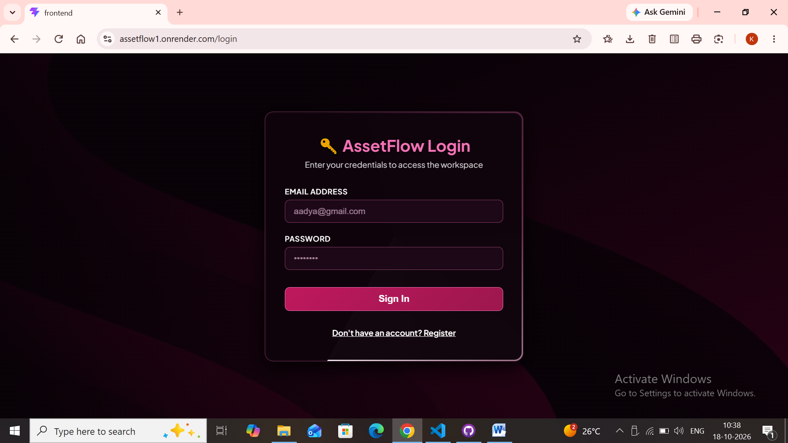
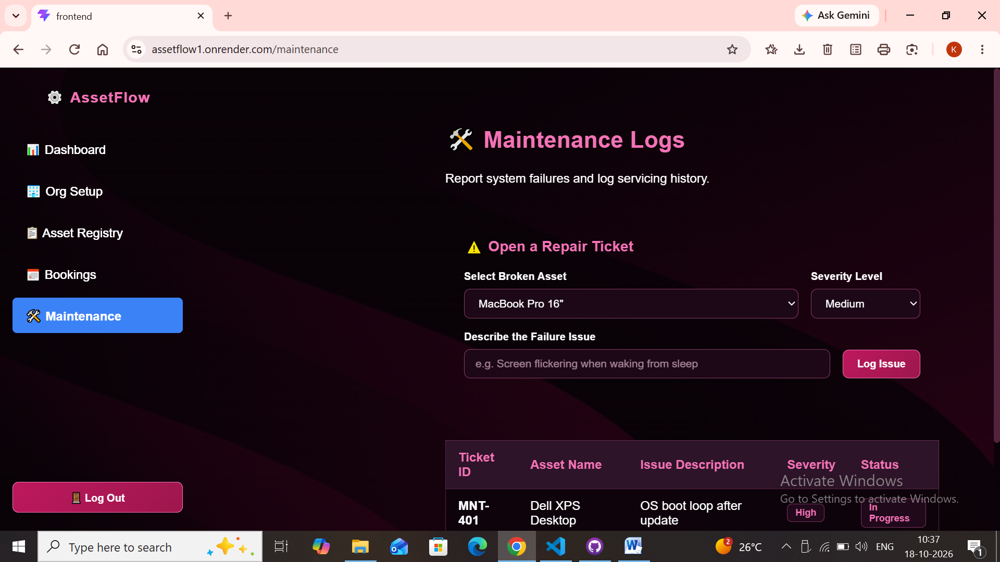

## AssetFlow 🏢📦
> **Enterprise Asset & Resource Management System**

[](https://assetflow1.onrender.com)
[](https://nodejs.org/)
[](https://expressjs.com/)
[](https://react.dev/)
[](https://www.sqlite.org/)

AssetFlow is a centralized Enterprise Resource Planning (ERP) platform designed to digitize and streamline how organizations track, allocate, and maintain their physical assets and shared resources. By eliminating manual spreadsheets and paper logs, it provides structured asset lifecycles, real-time tracking, time-slot resource bookings, and secure role-based workflows.

---

## 🌐 Live Application

Access the deployed application on Render:
👉 **[https://assetflow1.onrender.com](https://assetflow1.onrender.com)**

---

## 📸 Application Previews

<p align="center">
  
</p>

### 🔐 Secure Authentication & Access Control
The entry gateway features JWT authentication with hashed password security, protecting organization assets behind session control. Styled with a high-contrast pitch-black theme and subtle neon glows for an intuitive user experience.

---

<p align="center">
  
</p>

### 👥 User Onboarding & Organization Setup
Seamless account creation gateway that links users directly with departments and administrative clearance levels, establishing strict governance across asset allocation workflows.

---

## 📂 Project Structure

```bash
AssetFlow/
├── backend/
│   ├── config/             # Database and environment configurations
│   ├── controllers/        # Business logic for assets, auth, bookings, etc.
│   ├── middleware/         # Security and JWT authentication middleware
│   ├── models/             # Sequelize schemas (Asset, Booking, User, Department, etc.)
│   ├── routes/             # RESTful API routing endpoints
│   ├── database.sqlite     # SQLite database storage file
│   ├── server.js           # Express app entry point & static frontend server
│   └── package.json        # Backend dependencies & runtime scripts
├── frontend/
│   ├── public/             # Static web assets and icons
│   └── src/
│       ├── assets/         # Images and frontend media
│       ├── components/     # Reusable UI components (Sidebar, Navbar, Cards)
│       ├── context/        # Application state management
│       ├── pages/          # Primary views (Dashboard, Asset Registry, Booking, etc.)
│       ├── index.css       # Pitch-black neon aesthetic global stylesheet
│       └── main.jsx        # React DOM entry point
└── package.json            # Root monorepo configuration
```


## 🚀Core Features
#Secure Authentication: Role-secure backend with session validation and email/password login using JWT tokens and bcryptjs hashing.

Centralized Dashboard: Real-time KPI summaries tracking available/allocated assets, maintenance requests, active bookings, and total asset counts.

Organization Master Setup: Comprehensive management of departments, custom asset categories, and employee directories from a unified control center.

Asset Lifecycle Management: Complete status tracking through lifecycles: Available, Allocated, Reserved, Under Maintenance, Lost, Retired, and Disposed.

Conflict-Free Allocations: Prevent double-allocations with automated status checking and integrated transfer request workflows.

Time-Slot Resource Booking: Avoid scheduling clashes for shared rooms or equipment through real-time calendar overlap validation.

Maintenance Workflows: Multi-step repair management routing requests through priority approvals before updating asset statuses.

Periodic Audits: Assigned verification cycles that automatically flag missing or damaged items and compile discrepancy reports.

## 🛠️ Tech Stack & Architecture
Frontend: React.js, Vite, React Router DOM, Custom Glassmorphism CSS with Revolving Neon Borders.

Backend: Node.js, Express.js.

Database & ORM: SQLite3, Sequelize ORM.

Authentication: JSON Web Tokens (jsonwebtoken), bcryptjs.

Deployment: Single-service deployment on Render serving compiled static React files directly via Express.

## 🛠️ Local Installation & Setup
1. Clone the Repository
```bash
Bash
git clone [https://github.com/aadyadixit17-code/AssetFlow.git](https://github.com/aadyadixit17-code/AssetFlow.git)
cd AssetFlow
```

2. Configure Environment Variables
Create a .env file inside the backend/ directory:
```bash
Code snippet
PORT=5000
JWT_SECRET=your_custom_jwt_secret_key
NODE_ENV=development
```

3. Install & Run Dependencies
Backend Server:
```bash
Bash
cd backend
npm install
npm run dev
```

4. Frontend Development Server:
```bash
Bash
cd ../frontend
npm install
npm run dev
```

## ☁️ Deployment on Render (Single Web Service)
This repository is configured to deploy as a unified single service on Render:

Root Directory: backend

Build Command: npm install

Start Command: node server.js

Environment Variables:
```bash
JWT_SECRET: (Your chosen secure random key)
NODE_ENV: production
```